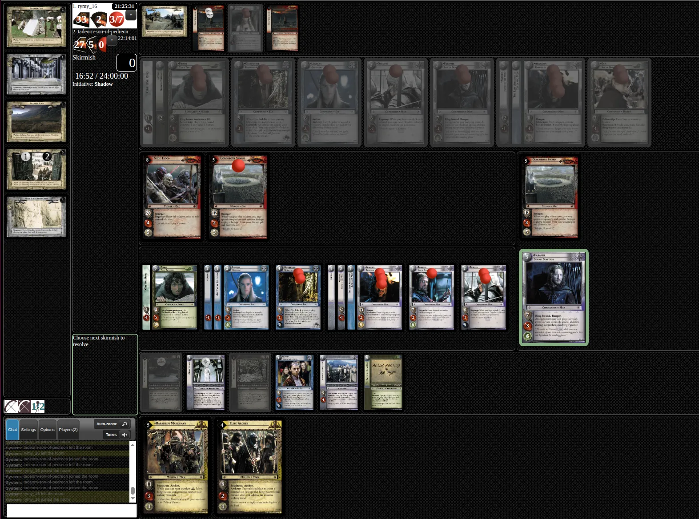

# Mobile Client – Remarks & Requirements

Notes from Piotr on the planned Android (phone and tablet) client for Gemp-LotR.
This file collects the goals first. The code analysis and implementation plan come later.

## Background

- Gemp-LotR is a card game made of a Java server and a JavaScript client.
- Today the game is played mainly in a web browser.
- The current UI is designed for desktop browsers and works poorly on Android phones and tablets.

## Goal

- A new client version for Android phones and tablets.
- It talks to the **same server** as the web client, so mobile players can play against web-browser players.

## Current game screen (desktop)

Areas on the screen, roughly left to right and top to bottom:

- **Adventure path:** a column on the far left with the site cards. Player position markers (1, 2) sit on the current site.
- **Game status panel:** player names, card and token counters, and clocks. Below that the current phase (Skirmish), the twilight pool (0), the game timer and the initiative (Shadow).
- **Decision prompt:** a box in the left column, for example "Choose next skirmish to resolve".
- **Chat and controls:** bottom left, with Chat, Settings, Options and Players tabs, plus Auto-zoom and Timer toggles.
- **Opponent's area (top):** the support area row, then the opponent's companions (shown greyed out).
- **Skirmishes (middle):** minions grouped against the companions they're assigned to. The active skirmish is shown separately on the right (Gorgoroth Swarm vs. Faramir, highlighted).
- **Own area:** companions with their attached cards, then the support area row.
- **Hand (bottom):** cards in hand (Haradrim Marksman, Elite Archer).

What makes this hard on a phone:

- Many full-size cards in each row, with card text too small to read.
- Small damage, wound and burden tokens stacked on top of the cards.
- A fixed multi-column desktop layout. The side panels take space the game table needs.
- Small click targets (tabs, the "+" buttons, the cards themselves).

## Remarks

<!-- Add remarks below, one per bullet. Group them under headings if useful. -->

- **Screen space:** the cards are large images, and they don't fit on a phone screen. You have to drag the whole page around to see the different groups of cards.
- **Interaction:** the UI has no drag and drop. Every action takes clicks (taps), all over the screen.
- **Covered cards:** cards that sit under other cards (attached or stacked) can't be seen, so there's no way to tell what's there.
- **Layout confirmed:** the top of the game screen is the opponent's area.

## Open questions

-
